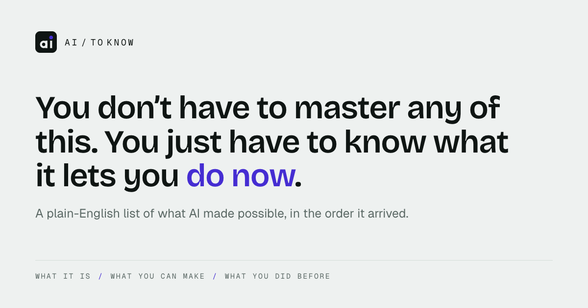

# AI to know: product knowledge

Everything a planner (human or AI) needs to write about this product without reading the
code: what it is, who it is for, how it talks, what it looks like, and what is on the list.
Written 2026-10-22. Facts that change (the list, the rules, the colours) have a source file
named next to them. When this doc and the source disagree, the source wins.



## 1. What it is

A public, plain-English list of AI capabilities. Every entry answers three questions:

1. **What is it?** One plain sentence, the way you would say it out loud.
2. **What can I make with it?** Three or four concrete things.
3. **What did I have to do before?** How people coped when it did not exist.

Entries are capabilities described in general, not products with logos. News, launches and
funding rounds do not appear. The list is short and grows slowly. The home page shows it as
a grid of cards, newest capability first (by the date it became usable).

Built and paid for by one person, Jordan Maulana.

## 2. Who it is for, and the promise

**Audience:** in the editorial file's own words, "a smart person who is not an engineer".
The site promises they need no course and no mastery. Knowing what is now possible is
enough to recognise the moment they need it.

**Hero line** (site and OG card):

> You don't have to master any of this. You just have to know what it lets you **do now**.

**Sub-line** (OG card): "A plain-English list of what AI made possible, in the order it arrived."

**Meta description:** "A plain-English list of AI capabilities: what each one is, what you
can make with it, and how people did it before it existed."

**About-page framing** (`frontend/src/routes/about.tsx`):

> Most writing about AI is news. Something launched, someone raised money. It arrives
> constantly and tells you almost nothing about what you can do this year that you couldn't
> do last year. This is the other list.

> Nothing here needs mastering. Knowing that a thing exists, and what it replaced, is enough
> to recognise the moment you need it.

## 3. The editorial bar

Source of truth: [`syllabus/editorial.py`](../../syllabus/editorial.py). It feeds the crawler,
the CMS rules page and the public `/about` page, so all three always match.

**The bar:** "Add it only if it lets someone do work that was impossible or wildly
impractical before."

| Qualifies | Does not qualify |
|---|---|
| A capability an ordinary person can now use that had no practical route before | Faster |
| No slower version of it existed to be sped up | Cheaper |
| Durable enough to still be true next quarter | A nicer version of an existing tool |
| General enough to outlive whichever product shipped it first | Model releases and version bumps, benchmark results, funding and acquisition news, drama and opinion pieces |

**Six categories:**

| Slug | Label | Covers |
|---|---|---|
| `build` | Build software | Writing and shipping software |
| `automate` | Automate work | Routine work done without doing it by hand |
| `agents` | Agents | Systems that take multi-step action on your behalf |
| `media` | Media | Making or editing images, audio and video |
| `interface` | Interfaces | New ways to talk to a machine: voice, or pointing a camera at it |
| `infra` | Infrastructure | The plumbing: running, serving and tuning models |

## 4. Voice: rules for any copy, social posts included

Source: `_VOICE` in [`syllabus/editorial.py`](../../syllabus/editorial.py). The site's own copy
follows these rules. Posts should too, because the brand rests on not sounding machine-written.

- Plain British English, for a smart non-engineer, in a speaking register.
- No hype. No exclamation marks.
- No em dashes. Use a full stop, comma, colon or brackets.
- No staged contrasts ("not A, but B", "X could do A; it could not do B"). State the thing.
- Do not open with an abstraction turning into a verb ("The barrier is gone"). Open with
  the concrete fact.
- No "no X, no Y, no Z" lists and no rule-of-three noun strings.
- Do not tell the reader why it matters. Say what happens.
- Vary the shape. One blunt sentence is fine.
- A named task or real document beats a general claim.

Tone reference, from the site footer: "Keeping this list current means reading the Hacker
News front page every day and paying a model to judge what is actually new. That bill is
real, and one person pays it."

## 5. How entries get on the list

1. **Daily crawl**, 08:00 Asia/Jakarta (`cron` service, `docker/crontab`). It pulls the
   Hacker News front page, drops off-topic and low-point stories for free, then has an
   OpenAI model judge the rest against the bar and the existing list.
2. **Research**: an editor types a topic at `/dashboard/research/` and a model with web
   search judges it the same way.
3. Anything accepted becomes a **draft**. A human publishes it in the CMS (`/dashboard/`).
   Nothing reaches the public site without that step.
4. Hand-written entries (`syllabus/seed_data.py`) are published straight away.

A newly published entry is a natural trigger for a post.

## 6. Public surfaces and links

| What | Where |
|---|---|
| Site (the list) | https://aiburnout.jordanmaulana.space/ |
| One entry | https://aiburnout.jordanmaulana.space/subjects/<slug> |
| How it works / the rules | https://aiburnout.jordanmaulana.space/about |
| Live list, JSON | `GET https://aiburnout.jordanmaulana.space/api/v1/syllabus/subjects/` (published only; `?category=`, `?q=`) |
| One entry, JSON | `GET .../api/v1/syllabus/subjects/<slug>/` |
| Rules, JSON | `GET .../api/v1/syllabus/editorial/` |
| Author | https://jordanmaulana.space |
| Sponsor ("Support this list") | https://github.com/sponsors/jordanmaulana |
| Analytics | Umami at umami.jordanmaulana.space (page views and session recordings) |

The list JSON gives `slug, title, one_liner, category, category_label, became_usable_on`.
The single-entry JSON adds `what_you_can_build` (list), `before_this`, `why_new`,
`resource_url`, `source_url` and `date_note`. Those fields are the raw material for posts.

**What a visitor can do:** browse the list, filter by category, search, open an entry, and
mark each entry New / Practicing / Tried / Mastered. Progress stays in their browser, with
no account needed. There is no newsletter or mailing list yet.

## 7. Brand

- **Name:** AI to know. **Wordmark:** `ai / to know`, set in Geist Mono, uppercase, widely
  letter-spaced, next to the square "ai" icon (`frontend/public/favicon.svg`).
- **Signature line:** WHAT IT IS / WHAT YOU CAN MAKE / WHAT YOU DID BEFORE (mono, uppercase,
  accent-coloured slashes).

| Token | Value | Use |
|---|---|---|
| paper | `#eef1f0` | Background |
| ink | `#0f1513` | Text, dark buttons |
| accent | `#452dd2` | One highlighted phrase ("do now"), slashes, links |
| muted | `hsl(165 7% 38%)` | Secondary text |
| rule | `hsl(155 10% 85%)` | Hairlines |
| card | `#ffffff` | Cards on paper |

| Font | Role |
|---|---|
| Bricolage Grotesque, semibold, tight tracking | Headlines |
| Geist | Body |
| Geist Mono, uppercase, wide tracking | Labels, eyebrows, wordmark |

Look: calm, paper-toned, lots of space, one accent colour used sparingly, no imagery or
gradients. Tokens live in `frontend/src/styles.css` (site) and `static/input.css` (CMS).

## 8. Open Graph image

File: [`og-image.png`](og-image.png), a copy for reference. The live one is
`frontend/public/og-image.png`, built from `frontend/brand/og.html`.

- 1200 × 630 px (1.91:1), PNG, about 65 KB.
- Served at https://aiburnout.jordanmaulana.space/og-image.png.
- Text on the card: wordmark, the hero line with "do now" in accent, the sub-line, and the
  signature line along the bottom.
- og:title: "AI to know — what became possible, and what you did before"
- Alt text: "AI to know — a plain-English list of what AI made possible"
- **Every page shares this one card.** Link-preview crawlers do not run the site's
  JavaScript, so a link to any single entry shows the same image and title.

To regenerate after editing `og.html` (run from `frontend/`, after `pnpm install` for the
fonts):

```sh
"/Applications/Google Chrome.app/Contents/MacOS/Google Chrome" --headless --hide-scrollbars \
  --force-device-scale-factor=1 --window-size=1200,630 \
  --screenshot=public/og-image.png "file://$PWD/brand/og.html"
```

## 9. Other assets

| Asset | Path | Notes |
|---|---|---|
| Promo video | `promo/ai-to-know promo.mp4` | 1080 × 1920 vertical, 58.5 s, with audio, about 22 MB. Fits Reels and Threads video as is. |
| Icon, vector | `frontend/public/favicon.svg` | |
| Icons, PNG | `frontend/public/icon-192.png`, `icon-512.png`, `apple-touch-icon.png` | 512 px works as a profile picture. |

## 10. Notes for Threads and Instagram

Facts to plan around. The strategy is left to whoever plans.

- The OG card fits a **Threads** link preview. It is the wrong shape for an **Instagram**
  feed post, which needs 1080 × 1080 or 1080 × 1350. No square or portrait art exists yet.
  Build it in the same style (paper background, Bricolage headline, one accent phrase,
  mono signature line), ideally from `brand/og.html` at a new window size.
- Instagram captions do not make links clickable. Posts there need "link in bio" pointing
  at the site or a specific `/subjects/<slug>` page.
- Each entry already has a post shape. Its three answers map onto a three-slide carousel or
  a three-part Threads post: what it is (`one_liner`), what you can make
  (`what_you_can_build`), what you did before (`before_this`). `why_new` gives a closing
  line.
- `became_usable_on` gives "on this day" hooks (see the table below).
- The footer's sponsor line is the honest ask: one person reads Hacker News daily and pays
  the model bill.

## 11. Subject snapshot (2026-10-22)

These are the 23 hand-written entries in `syllabus/seed_data.py`, sorted by when ordinary
people could first use each one. **This is a snapshot.** Entries published from the crawler
are not included, and wording may have changed. Fetch the live list from the API before
quoting any entry.

| Usable from | Title | Slug | Category | One-liner |
|---|---|---|---|---|
| 2022-06-21 | AI-assisted coding | `ai-assisted-coding` | build | An editor that writes the next few lines for you and answers questions about the code in front of you. |
| 2022-08-22 | Image generation | `image-generation` | media | Describe a picture in words and get the picture. |
| 2022-09-21 | Speech-to-text that actually works | `speech-to-text` | interface | Accurate transcription of ordinary speech, accents and background noise included, cheap enough to run on everything you record. |
| 2022-12-15 | Embeddings and semantic search | `embeddings-semantic-search` | build | Turn text, images, or audio into coordinates, so things that mean the same thing land near each other. You search by meaning rather than by wording. |
| 2023-01-23 | Natural text-to-speech and voice cloning | `voice-cloning-tts` | media | Speech synthesis that sounds like a person, in any voice you have a short sample of. |
| 2023-02-10 | Fine-tuning and LoRA | `fine-tuning-lora` | infra | Nudge an existing model toward your style, format, or niche vocabulary using a few hundred examples and a modest budget. |
| 2023-03-01 | RAG: retrieval-augmented generation | `rag` | build | Give a language model your own documents at question time, so it answers from your material instead of from what it memorised during training. |
| 2023-03-10 | Running models on your own machine | `local-llms` | infra | Capable open-weight models that run on a laptop, with no API bill and nothing leaving the building. |
| 2023-03-13 | Synthetic data generation | `synthetic-data` | build | Generate realistic-but-fake records, conversations, or examples to test, demo, or train with. |
| 2023-05-23 | Editing images by asking | `instruction-image-editing` | media | Change a photo by describing the change. Remove the bin, swap the background, extend the frame, without touching a selection tool. |
| 2023-06-09 | Evals and LLM-as-judge | `evals-llm-judge` | infra | Grade the quality of open-ended output automatically, using a model as the marker against a written rubric. |
| 2023-06-13 | Tool use: models that call your functions | `tool-use` | agents | You describe the functions a model is allowed to call; it decides when to call them and what to pass in, then uses the result. |
| 2023-07-06 | Text-to-SQL and natural-language BI | `text-to-sql` | build | Ask a question about your data in English; get the query, the numbers, and the chart. |
| 2023-09-25 | Models that can see | `vision-llms` | build | Send an image and ask a question about it in plain language. There is no training step and no fixed list of things it can recognise. |
| 2023-12-01 | AI in workflow automation (n8n, Make, Zapier) | `n8n-ai-automation` | automate | Drag-and-drop automation tools with a language model as one of the boxes, so steps that need judgement stop needing a person. |
| 2024-03-04 | Document extraction without templates | `document-extraction` | automate | Pull structured data out of PDFs, scans, and photos whatever the layout, with no per-vendor template to configure. |
| 2024-04-09 | Long context windows | `long-context` | infra | Models that hold a whole book, codebase, or year of email in view at once, hundreds of thousands of words per question. |
| 2024-08-06 | Structured outputs | `structured-outputs` | build | Hand the model a schema and get back JSON that matches it every time, ready to feed straight into the rest of your program. |
| 2024-10-01 | Realtime voice agents | `realtime-voice-agents` | interface | Speech in, speech out, fast enough that you can cut in mid-sentence and it holds up as an actual phone conversation. |
| 2024-10-22 | Computer use and browser agents | `computer-use` | agents | A model that looks at a screen and moves the mouse and keyboard, driving software the way a person does, with no API required. |
| 2024-11-25 | MCP: the Model Context Protocol | `mcp` | infra | A standard plug shape for connecting AI assistants to tools and data. Write one connector per service and any assistant that speaks it can use it. |
| 2024-12-09 | Video generation | `video-generation` | media | Generate short video clips from a description or a still image, including camera movement and consistent characters. |
| 2025-02-24 | Coding agents | `coding-agents` | agents | A model that works in your actual repository. It reads files, edits them, runs the tests, and fixes what it broke. |

## 12. Where the current version lives

| Topic | Source |
|---|---|
| Editorial bar, categories, voice rules | `syllabus/editorial.py` |
| Category labels | `syllabus/models.py` (`Category`) |
| Hand-written entries, full text | `syllabus/seed_data.py` |
| Live published list | `GET /api/v1/syllabus/subjects/` |
| Hero and landing copy | `frontend/src/routes/index.tsx` |
| About-page copy | `frontend/src/routes/about.tsx` |
| Footer and sponsor copy | `frontend/src/components/layout/site-footer.tsx` |
| Meta tags, OG tags, domain | `frontend/index.html` |
| OG card source | `frontend/brand/og.html` |
| Colours and fonts | `frontend/src/styles.css`, `static/input.css` |
| Crawl schedule | `docker/crontab` (TZ in `docker-compose.yml`) |
