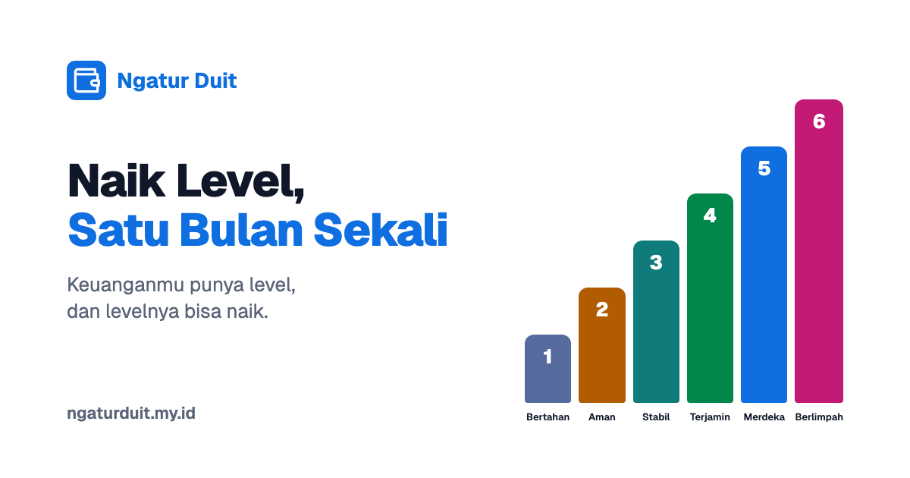

# Brand: visual, gambar, tautan

## Prinsip visual

- **Terang (light mode) untuk semua materi.** Jordan: aplikasi keuangan yang dia kenal semuanya terang. Mode gelap ada di aplikasi, tapi hanya bisa dipilih manual.
- **Palet diambil dari seri uang kertas Rupiah.** Biru Rp50.000 jadi warna utama.
- **Merah hanya untuk pengeluaran.** Tangga kekayaan tidak pernah memakai merah.
- Bersih dan datar: kartu putih di atas latar abu kebiruan, sudut membulat, angka rata kanan dengan angka tabular.

## Warna

Sumber: `frontend/src/index.css` (token) dan `frontend/src/lib/chartTheme.ts` (hex untuk grafik). Kalau warnanya berubah di sana, file ini ikut diubah.

### Warna utama

| Peran | Uang kertas | Utama | Teks | Latar tipis |
|---|---|---|---|---|
| Primary / brand | Rp50.000 biru | `#0F6FE0` | `#0B58B8` | `#E4F0FF` |
| Pemasukan | Rp20.000 hijau | `#008749` | `#076E42` | `#DFF6E8` |
| Pengeluaran | Rp100.000 merah | `#E01B26` | `#B01018` | `#FFE6E6` |
| Transfer | Rp10.000 ungu | `#7C3AED` | `#6425D0` | `#EFE7FE` |
| Peringatan | Rp5.000 jingga | `#B15C00` | `#8A4600` | `#FFEEDB` |

### Netral

| Peran | Hex |
|---|---|
| Latar halaman | `#F4F6FA` |
| Kartu | `#FFFFFF` |
| Teks utama | `#0F1729` |
| Teks redup | `#5A6478` |
| Garis | `#E1E7F0` |

### Warna level kekayaan

| Level | Nama | Hex |
|---|---|---|
| 1 | Bertahan | `#556B9E` (abu biru) |
| 2 | Aman | `#B15C00` (jingga) |
| 3 | Stabil | `#0F7C7B` (teal) |
| 4 | Terjamin | `#008749` (hijau) |
| 5 | Merdeka | `#0F6FE0` (biru) |
| 6 | Berlimpah | `#C21A74` (magenta) |

### Warna grafik (urutan kategori)

`#1C86EE` (Rp50.000), `#C98200` (Rp5.000), `#8B47E8` (Rp10.000), `#1FA85C` (Rp20.000), `#E8309B` (Rp75.000), `#88950A` (Rp2.000), `#12908F` (Rp1.000), `#E7301F` (Rp100.000). Merah selalu di urutan terakhir supaya grafik pengeluaran tidak dibuka dengan warna yang sudah berarti "pengeluaran". Palet ini sudah lolos uji kontras dan buta warna; jalankan ulang validatornya (perintah di header `frontend/src/index.css`) sebelum mengganti warna.

## Huruf

- **Geist** (variable) untuk semua teks. Judul memakai huruf yang sama, dibedakan dengan ketebalan.
- **Geist Mono** hanya untuk angka yang perlu rata kolom.
- Nominal uang memakai angka tabular.
- Gratis, dari Vercel; di kode lewat paket `@fontsource-variable`.

## Logo

- **Ikon:** glyph dompet (lucide "Wallet") garis putih di kotak biru `#0F6FE0` bersudut membulat (radius 7 dari 32).
- **Wordmark:** "Ngatur Duit" tebal, biru primary, di samping ikon.
- File yang tersedia:
  - `frontend/public/favicon.svg` (vektor, bisa diperbesar untuk avatar)
  - `frontend/public/favicon.ico` (16 dan 32 px)
  - `frontend/public/apple-touch-icon.png` (180×180)
- Belum ada file logo besar (PNG/SVG wordmark) terpisah. Untuk foto profil media sosial, perbesar `favicon.svg`.

## Gambar Open Graph



- **File:** [og.png](og.png), salinan dari `frontend/public/og.png` (yang dipakai situs). Kalau salah satunya diganti, samakan keduanya.
- **Ukuran:** 1200×630 px, PNG, sekitar 44 KB, latar putih.
- **Isi kiri:** ikon + "Ngatur Duit" biru, judul "Naik Level," (gelap) dan "Satu Bulan Sekali" (biru), subjudul "Keuanganmu punya level, dan levelnya bisa naik.", alamat "ngaturduit.my.id" di bawah.
- **Isi kanan:** enam batang naik bernomor 1–6 dengan warna level, berlabel Bertahan, Aman, Stabil, Terjamin, Merdeka, Berlimpah.
- **Teks alternatif:** "Ngatur Duit: Naik Level, Satu Bulan Sekali"
- **Asal:** dibuat di luar repo (masuk 27 Sep 2026, commit `306d286`). Tidak ada file sumber atau skrip pembuatnya. Kalau perlu versi baru, buat ulang dari spesifikasi di atas.

Meta tag di `frontend/index.html`:

```html
<title>Naik Level, Satu Bulan Sekali · Ngatur Duit</title>
<meta property="og:type" content="website" />
<meta property="og:site_name" content="Ngatur Duit" />
<meta property="og:locale" content="id_ID" />
<meta property="og:url" content="https://ngaturduit.my.id/" />
<meta property="og:title" content="Naik Level, Satu Bulan Sekali · Ngatur Duit" />
<meta property="og:description" content="Keuanganmu punya level, dan levelnya bisa naik. Aplikasi ini menunjukkan kamu ada di mana sekarang, apa yang sedang menahan, dan berapa jauh lagi ke level berikutnya." />
<meta property="og:image" content="https://ngaturduit.my.id/og.png" />
<meta name="twitter:card" content="summary_large_image" />
```

## Tautan resmi

| Apa | Tautan |
|---|---|
| Situs | https://ngaturduit.my.id |
| Daftar | https://ngaturduit.my.id/register |
| Masuk | https://ngaturduit.my.id/login |
| Bot Telegram | https://t.me/ngatur_duit_bot |
| Gambar OG | https://ngaturduit.my.id/og.png |

- Bagian tangga di landing punya jangkar `#tangga` (tombol "Lihat tangganya").
- CTA di landing: "Coba Sekarang".
- Sitemap hanya berisi `/`, `/login`, `/register`. Halaman di bawah `/app/` tidak diindeks.
- Situs memakai analitik Umami.
- **Belum ada:** akun media sosial, email kontak publik, halaman kebijakan privasi, halaman syarat dan ketentuan. Kebijakan privasi dan S&K masih di daftar `todo.md`.
